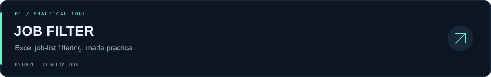
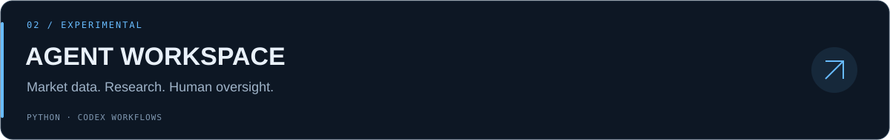
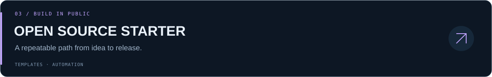

  

  <a href="#projects">项目 / Projects</a> ·
  <a href="#exploring">探索 / Exploring</a> ·
  <a href="https://github.com/shanghe000/.github/blob/main/docs/PLAYBOOK.md">开源手册 / Playbook</a>

### 你好，我是 shanghe000 👋

把想法做成工具，把探索留成开源。

我在探索 **AI Agent 工作流、实用自动化工具与后端系统**。这里记录我正在做的东西，也记录从实验走向可复用项目的过程。

*Building useful tools, exploring agent workflows, and sharing what I learn along the way.*

## Selected projects

**[公考职位表筛选器](https://github.com/shanghe000/job_filter)** · 选择 Excel，按学历、专业等条件筛选，保留原表格式并另存结果。提供 Windows / macOS 打包流程。

**[Codex 研究工作空间](https://github.com/shanghe000/auto_trade_workspace_for_codex)** · 行情采集、模拟账户只读观察、策略治理与过程记录。**实验阶段，尚未开放实盘执行**。

**[开源项目起步模板](https://github.com/shanghe000/open-source-starter)** · 让每个新项目从清晰的说明、贡献入口、自动检查和可审核的发布流程开始。

## Currently exploring

| 方向 | 正在关注 |
| :--- | :--- |
| Agent workflows | Codex、工具协作、可追溯的执行流程 |
| Practical automation | Python、数据处理、桌面小工具 |
| Systems foundations | RPC、存储与后端基础；[PRPC 学习记录](https://github.com/shanghe000/PRPC) |

## Build, document, share

小步实现 → 写清用途与限制 → 检查与评审 → 发布 → 继续迭代。

欢迎到具体项目的 Issues 交流使用问题与想法。原创项目见上方；Fork 仓库用于学习和跟进上游，原作者与许可证以各仓库说明为准。

Useful over flashy. Curious by default. Built in the open.

