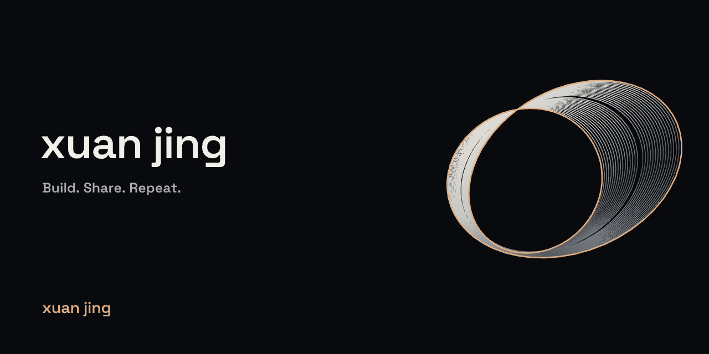

# xuan jing · Brand kit

**Build. Share. Repeat.**

一个连续的莫比乌斯形态，连接创作、分享与迭代。头像、动态主页和项目封面使用同一套几何母形。



## 固定的视觉语言

| 元素 | 约定 |
| --- | --- |
| 名字 | `xuan jing`，小写，保留空格 |
| 墨黑背景 | `#080A0D` |
| 暖白字标 | `#F2EFE8` |
| 银色辅助文字 | `#A9ACAE` |
| 暖铜色轮廓与签名 | `#E7AA7A`，少量使用 |
| 字体 | Space Grotesk，字形转路径后发布，避免加载外部字体 |
| 核心形态 | 莫比乌斯带；头像用粗线，封面用细线 |
| 排版 | 左侧标题、右侧形体、左下角作者；大面积留白 |
| 动态 | 主页保留缓慢翻转；头像与分享图采用静态定格 |

头像不加文字，兼顾圆形裁切与小尺寸。封面只放项目名、一句说明与作者签名，不堆叠技术标签、徽章或数据。
项目可以选择不同的形体角度；配色、字体和作者位置保持一致。实际功能与研究状态以项目说明为准，视觉不暗示额外成熟度。

[下载完整品牌素材包](../brand-kit.zip)（头像、封面、动态头图、字体许可和生成脚本）

## 可直接使用的素材

| 用途 | PNG | SVG |
| --- | --- | --- |
| 头像 · 512 × 512 | [下载](avatar.png) | [矢量](avatar.svg) |
| 个人品牌 · 1280 × 640 | [下载](profile.png) | [矢量](profile.svg) |
| Job Filter | [下载](job-filter.png) | [矢量](job-filter.svg) |
| Open Source Starter | [下载](open-source-starter.png) | [矢量](open-source-starter.svg) |
| Open-source Workshop | [下载](community.png) | [矢量](community.svg) |
| Codex Workspace | [下载](codex-workspace.png) | [矢量](codex-workspace.svg) |
| PRPC | [下载](prpc.png) | [矢量](prpc.svg) |

README 使用 SVG，保持不同屏幕下清晰；GitHub 的头像与 Social preview 使用 PNG。
Social preview 在各仓库的 Settings → General 中单独设置，不会由 README 或模板自动继承。

## 为下一个项目生成封面

在这个主页仓库中安装 `fonttools==4.68.0`，运行：

```sh
python scripts/build_brand.py --title 'My Project' --subtitle 'One clear purpose.' --output assets/brand/my-project.svg
```

标题可用 `|` 分为两行，例如 `'My Project|Studio'`。使用简短英文标题；中文完整介绍放在 README 中。
将 SVG 以 1280 × 640 导出为 PNG，检查完整画布、无留白边框和字体溢出，再上传为分享图。
不带参数运行 `python scripts/build_brand.py` 会重新生成这套标准 SVG；`python scripts/build_header.py` 生成动态主页头图。
PNG 是对应 SVG 的浏览器渲染导出，更新 SVG 后需一并导出。

## 来源与许可

品牌几何、排版和脚本沿用本仓库的 [MIT 许可](../../LICENSE)。
Space Grotesk 字体来源及 [SIL Open Font License](../fonts/OFL.txt) 保留在 `assets/fonts/`。
